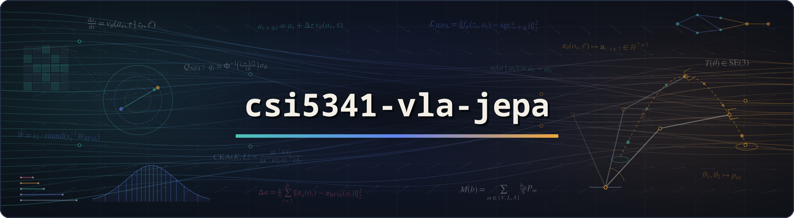

<p align="center"><i>How small can VLA-JEPA get? Post-training compression of a robot policy, measured on LIBERO.</i></p>

<p align="center">
  <a href="https://github.com/seofernando25/csi5341-vla-jepa/actions/workflows/ci.yml"></a>
</p>

<p align="center">
  <a href="#status"><b>Status</b></a> ·
  <a href="report/"><b>Report</b></a> ·
  <a href="studies/README.md"><b>Evidence</b></a> ·
  <a href="docs/COMMANDS.md"><b>Commands</b></a> ·
  <a href="web/presentation/README.md"><b>Presentation</b></a>
</p>

---

CSI 5341 course project by Noah Sprenger and Fernando Nogueira. We compress the released
[VLA-JEPA](https://arxiv.org/abs/2602.10098) LIBERO policy after training and measure what
it costs in task success, latency and GPU memory.

**[Report source](report/)** · [Studies and evidence](studies/README.md) · [Paper presentation](web/presentation/README.md)

## Status

Clean-room reset, 2026-11-15. The pre-cleanroom compression and Dream-RSI evidence was deleted from
the working tree and remains in Git history at tag `pre-cleanroom-20261115`. It is not reused,
pooled or cited, and the report quotes none of it.

The new evidence base is [studies/program-v1/](studies/program-v1/README.md): a frozen protocol, a
pre-registered precision surface of 13 arms with its development measurements, and the Dream-RSI
search cycles. The reserved 500-trial runs of the v1 selection are complete. Later Dream-RSI
searches (size under open protocol, size without hints, latency) are in
[studies/README.md](studies/README.md). The program (decided arms, gates, stop rules) is
[docs/COMPRESSION_PROGRAM.md](docs/COMPRESSION_PROGRAM.md); run state is in `HANDOFF.md`.

## Layout

| Path | Contents |
|---|---|
| `report/` | Final IEEE report: `main.tex`, `plots/` (all figures from committed evidence), `data/numbers.json` |
| `studies/` | Compact evidence for every experiment: run records, per-episode CSVs, milestones |
| `evaluation/` | Rollouts, timing, analysis; compression recipes and transforms in `evaluation/compression/` |
| `rsi/` | Dream-RSI search over compression solutions: discovery agents, fixed evaluator, replay, policy development |
| `docs/COMMANDS.md` | One canonical command per task |
| `web/presentation/` | Paper presentation (October milestone; not yet updated to the final results) |
| `tests/` | Unit tests for statistics, compression transforms and the search |

## Setup

Linux with an NVIDIA GPU for rollouts and timing; any machine for tests and the report.

```bash
CMAKE_POLICY_VERSION_MINIMUM=3.5 uv sync --extra dev --extra eval --extra report
uv run --no-sync pytest -q -m "not slow"
uv run --no-sync vla-report-plots           # skips figures whose evidence is absent
cd report && latexmk -pdf main.tex           # rebuild the PDF
```

Run `uv sync` with the extras above; a plain `uv run` re-syncs and drops them.
Reproduction commands for each study are in its README under [studies/](studies/README.md).

LeRobot is pinned to `30074f7f1358b3c015ae1750017200e86e9c4eb6`. No weights or datasets are
redistributed; see [NOTICE.md](NOTICE.md).

References: [VLA-JEPA](https://arxiv.org/abs/2602.10098), [V-JEPA 2](https://arxiv.org/abs/2506.09985),
[SmolVLM](https://arxiv.org/abs/2504.05299), [LIBERO](https://arxiv.org/abs/2306.03310),
[Dream-RSI](https://arxiv.org/abs/2609.14858).
