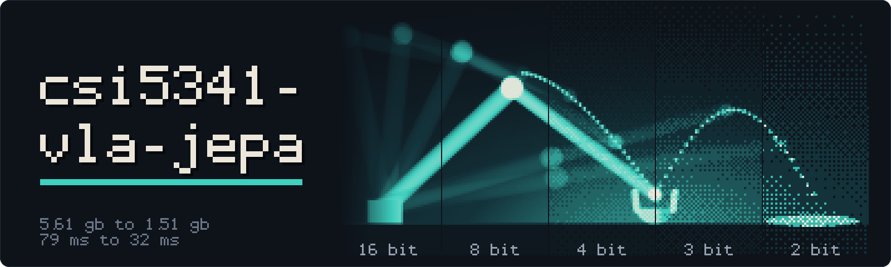

<p align="center"><i>How small can VLA-JEPA get? Post-training compression of a robot policy, measured on LIBERO.</i></p>

<p align="center">
  <a href="https://github.com/seofernando25/csi5341-vla-jepa/actions/workflows/ci.yml"></a>
</p>

<p align="center">
  <a href="#results"><b>Results</b></a> ·
  <a href="report/main.pdf"><b>Report</b></a> ·
  <a href="studies/README.md"><b>Evidence</b></a> ·
  <a href="docs/COMMANDS.md"><b>Commands</b></a> ·
  <a href="web/presentation/README.md"><b>Presentation</b></a>
</p>

---

CSI 5341 course project by Noah Sprenger and Fernando Nogueira. We compress the released
[VLA-JEPA](https://arxiv.org/abs/2602.10098) LIBERO policy after training and measure what
it costs in task success, latency and GPU memory.

**[Final report (PDF)](report/main.pdf)** · [Report source](report/) · [Studies and evidence](studies/README.md) · [Paper presentation](web/presentation/README.md)

## Results

LIBERO-Spatial, 500 reserved trials per configuration, one RTX 3090, batch size 1. Changes are
paired against B16 on identical initial states and seeds.

| Configuration | Success | Δ vs B16, pp [95% CI] | Peak memory | Median latency |
|---|---:|---:|---:|---:|
| B16: released BF16 policy | 95.0% | — | 5.61 GB | 79 ms |
| Q8: LLM.int8 language decoder | 94.8% | −0.2 [−1.2, +0.8] | 4.30 GB (−23%) | 157 ms |
| Q4: NF4 language decoder | 95.8% | +0.8 [−0.6, +2.2] | 3.54 GB (−37%) | 94 ms |
| C1: NF4 language, 2-bit HQQ vision/action, INT8 embeddings | 96.8% | +1.8 [−0.2, +3.8] | 1.38 GB (−75%) | 143 ms |
| C2: NF4 everywhere, INT8 embeddings, 1 flow step, CUDA-graph engine¹ | 98.0% | +3.0 [+1.4, +4.8] | 1.51 GB (−73%) | 32 ms |
| S500: SmolVLM2-500M backbone, fine-tuned | 2.2% | −92.8 | 3.30 GB (−41%) | 1270 ms |

¹ No pruning, no calibration data. Peak is allocated memory (2.71 GB reserved).

- NF4 decoder quantization meets the proposal target (≥25% less memory, ≤5 points lost). LLM.int8
  misses it: 25.1% is its theoretical ceiling.
- The language decoder limits compression. Vision and action weights tolerate 2-bit quantization.
- Under the stock execution path every compressed policy is slower at batch size 1: it is launch-bound.
  A CUDA-graph engine (`evaluation/fastpath.py`) makes B16 itself 28.5 ms (474/500, success-neutral);
  C2 then runs at 31.6 ms in 1.51 GB.
- Offline action change on fixed frames screens out bad recipes (Spearman ρ = −0.67 over 163)
  but cannot rank near-lossless ones.
- Replacing Qwen with SmolVLM2-500M failed within our training budget.

## Layout

| Path | Contents |
|---|---|
| `report/` | Final IEEE report: `main.tex`, `plots/` (all figures from committed evidence), `data/numbers.json` |
| `studies/` | Compact evidence for every experiment: run records, per-episode CSVs, milestones |
| `evaluation/` | Rollouts, timing, analysis; compression recipes and transforms in `evaluation/compression/` |
| `rsi/` | Dream-RSI search over compression recipes: replay, gates, live rounds |
| `docs/COMMANDS.md` | One canonical command per task |
| `web/presentation/` | Paper presentation (October milestone) |
| `tests/` | Unit tests for statistics, compression transforms and the search |

## Setup

Linux with an NVIDIA GPU for rollouts and timing; any machine for tests and the report.

```bash
CMAKE_POLICY_VERSION_MINIMUM=3.5 uv sync --extra dev --extra eval --extra report
uv run --no-sync pytest
uv run --no-sync python -m report.plots     # rebuild figures and numbers.json
cd report && latexmk -pdf main.tex           # rebuild the PDF
```

Run `uv sync` with the extras above; a plain `uv run` re-syncs and drops them.
Reproduction commands for each study are in its README under [studies/](studies/README.md).

LeRobot is pinned to `30074f7f1358b3c015ae1750017200e86e9c4eb6`. No weights or datasets are
redistributed; see [NOTICE.md](NOTICE.md).

References: [VLA-JEPA](https://arxiv.org/abs/2602.10098), [V-JEPA 2](https://arxiv.org/abs/2506.09985),
[SmolVLM](https://arxiv.org/abs/2504.05299), [LIBERO](https://arxiv.org/abs/2306.03310),
[Dream-RSI](https://arxiv.org/abs/2609.14858).
